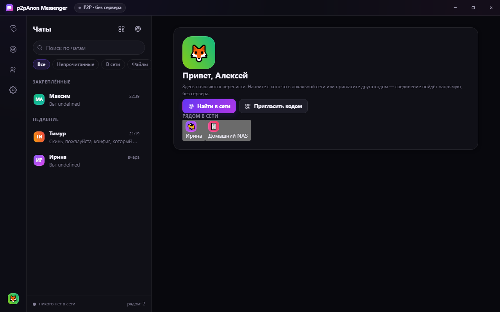
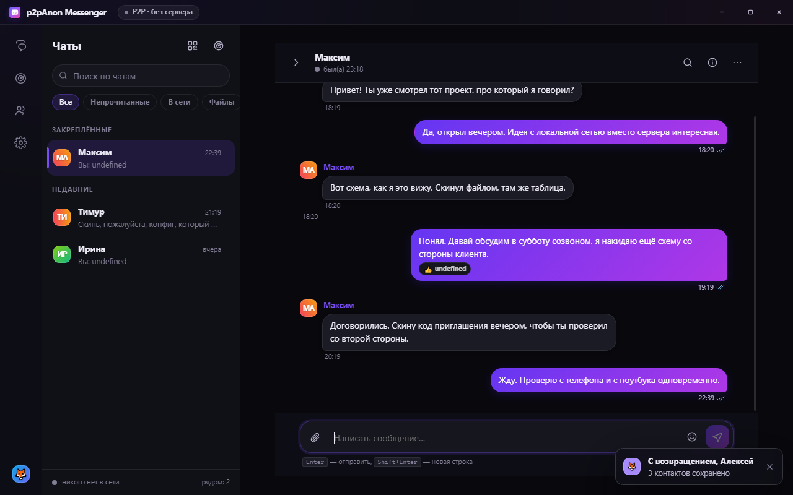
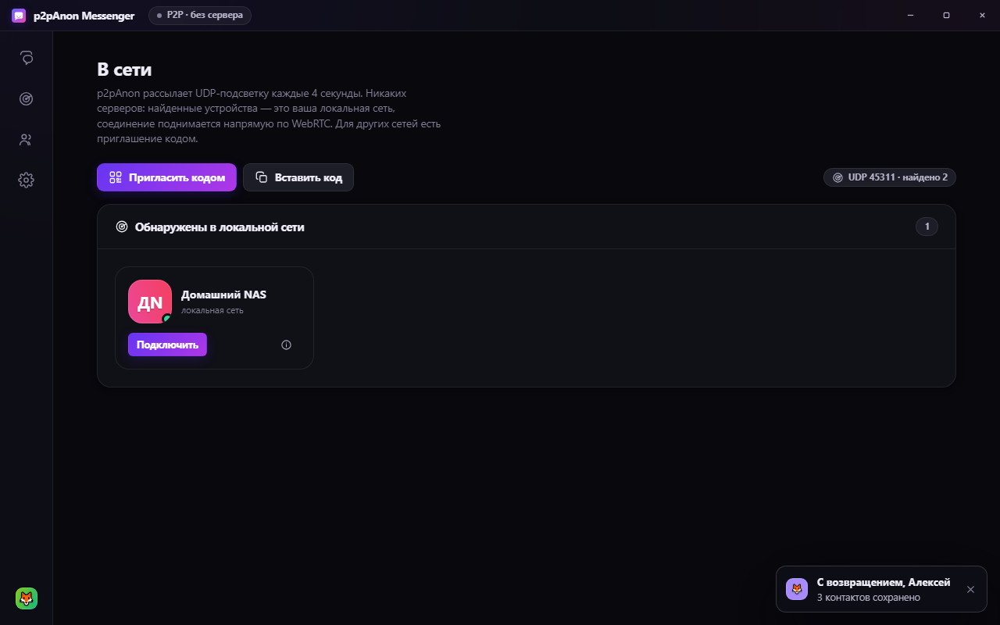
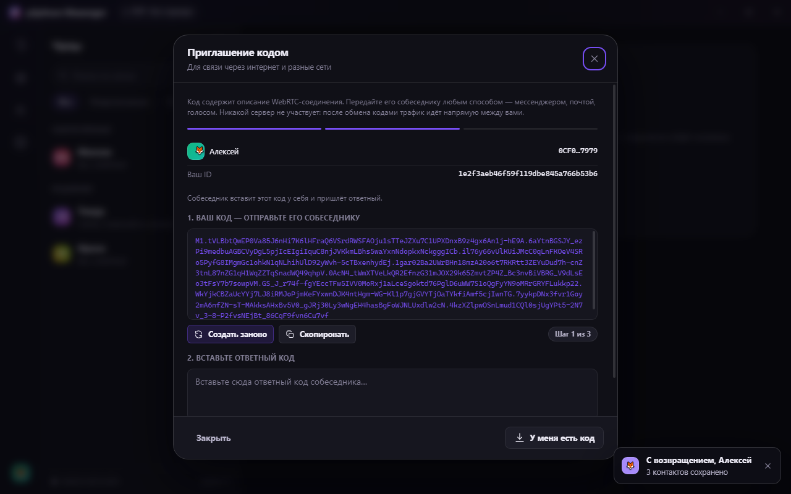
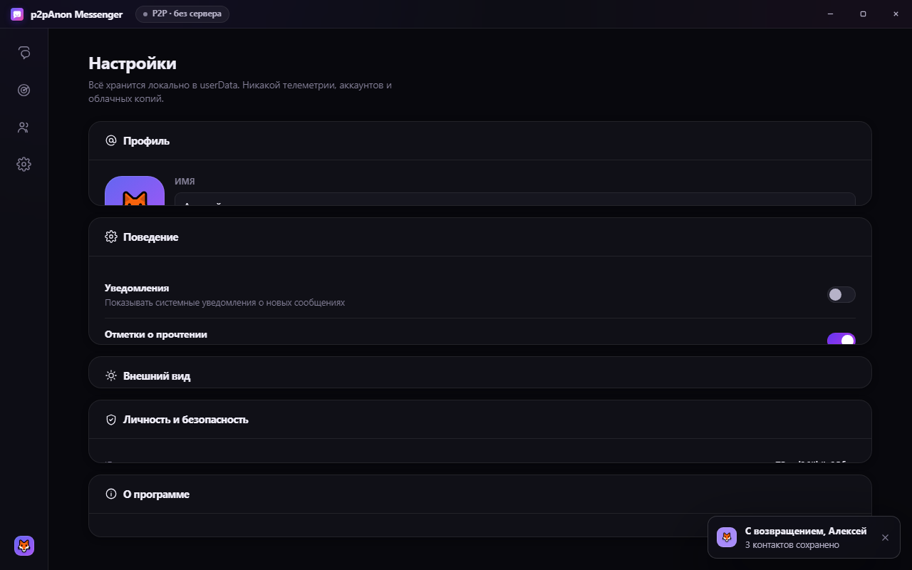
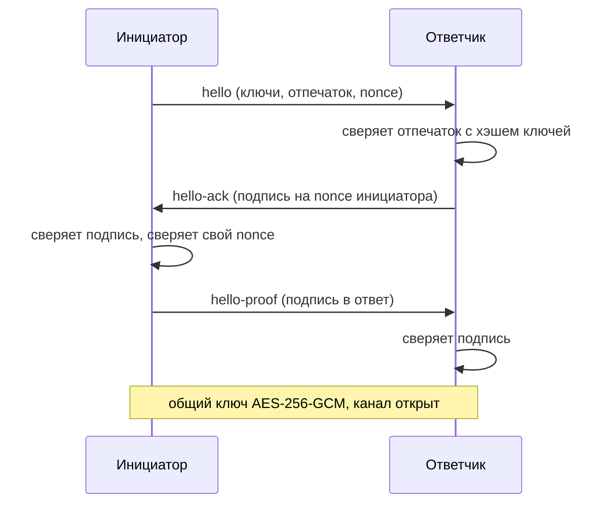

# p2pAnon Messenger

Мессенджер, у которого нет сервера. Нет аккаунтов, нет базы, нет домена, нет владельца, который может сказать «выключить». Два человека связываются напрямую — по локальной сети или через обмен кодом, — и дальше разговаривают напрямую.

Windows, Electron, около 9000 строк в `src/` и 2000 строк тестов. Собирается из исходников, которые лежат в этом репозитории.



---

## Как это выглядит

<table>
<tr>
<td width="50%"></td>
<td width="50%"></td>
</tr>
<tr>
<td align="center">Список чатов</td>
<td align="center">Переписка, файл, реакции</td>
</tr>
</table>

Соединение внутри одной сети и через интернет:

<table>
<tr>
<td width="50%"></td>
<td width="50%"></td>
</tr>
<tr>
<td align="center">Соседи в локальной сети</td>
<td align="center">Код приглашения: сервер не нужен</td>
</tr>
</table>



> Скриншоты снимаются автоматически командой `npm run shots` на выдуманных данных: отдельный временный профиль, вымышленные имена и переписка. Ни одна реальная переписка в репозиторий попасть не может — сборка сама проверяет, что на экране нет вашего имени пользователя и что в код приглашения не попал реальный адрес машины.

---

## Три способа связаться

**1. Один Wi-Fi.** Приложение рассылает UDP- broadcast в диапазоне `45311–45315` и находит соседей автоматически. Никаких кодов, ничего настраивать не надо: оба открыли программу и увидели друг друга. Это работает даже без интернета.

**2. Разные сети.** Один человек жмёт «Пригласить кодом» и отдаёт собеседнику длинный текстовый блок. Этот блок — описание WebRTC-соединения, сжатое и зашифрованное. Второй вставляет его у себя, и появляется соединение. Никакой посредник не участвует, даже для первой встречи: код можно передать голосом, на бумаге, через любой мессенджер, флешкой — как удобно.

**3. Кто-то уже есть в контактах.** Контакт добавляется один раз и дальше поднимается сам, когда обе машины в одной сети.

---

## Что именно защищено

| | |
|---|---|
| Ключи | ECDH P-256, своя пара на устройство, живёт только в вашем профиле |
| Подпись личности | ECDSA P-256, рукопожатие подписано с обеих сторон |
| Сессионный ключ | ECDH + HKDF, соль из **обоих** публичных ключей |
| Сообщения и файлы | AES-256-GCM, отдельный nonce на каждое сообщение |
| Файлы | передаются чанками по 48 КБ, собираются на диске и сверяются по размеру |
| Подтверждение личности | шесть групп по пять цифр — сверяйте голосом при встрече |

Ключи не покидают устройство. Ни один бит переписки не проходит через чужой сервер, потому что сервера нет. Содержимое файлов тоже не шифруется отдельно — оно идёт внутри того же зашифрованного канала.

**Про «анонимность» честно.** Это не анонимный мессенджер в смысле Tor. Собеседник по определению видит ваш IP-адрес — на то он и собеседник, это цена прямого соединения без сервера. Что вы получаете: нет аккаунта, который можно привязать к номеру телефона, нет истории, которая живёт не у вас, и нет организации, у которой можно запросить её выдать.

---

## Про блокировки

Что здесь действительно даёт:

- **Нечего блокировать на уровне приложения.** Нет сервиса, нет аккаунтов, нет push-рассылки, нет вебхуков. Нельзя отозвать доступ у конкретного человека, нельзя заблокировать «базу пользователей», нельзя потребовать выдать содержимое переписки — его не существует вовсе.
- **Нет точки отказа.** Провайдер или регулятор не может выключить мессенджер целиком: работают отдельные устройства. Модерации, рейтинга, теневого баня нет и быть не может.
- **Код приглашения — это файл, а не ссылка.** Ссылку можно заблокировать доменом. Код можно передать чем угодно, и у него нет адреса, который куда-то ведёт.
- **Трафик идёт напрямую** по WebRTC, на произвольных UDP-портах, а не через распознаваемый прокси-протокол приложения.

Чего это **не** делает, и про это надо сказать прямо:

- **Ваш IP видят обе стороны и оператор связи.** Прямое соединение не анонимизирует — оно его делает явным.
- **Оператор видит сам факт соединения**: два адреса, UDP-поток, его объём и время. Само содержимое зашифровано, но метаданные — нет.
- **DPI умеет распознавать WebRTC.** Поток на нестандартных портах выглядит характерно. Грамотная фильтрация способна его резать, и у этого приложения нет контрмер. Оно повышает цену блокировки, но не делает её невозможной.
- **Прямо сейчас код завязан на публичные STUN-серверы Google и Cloudflare.** Это заметные адреса, и в сети, где они заблокированы, связь между разными сетями не поднимется. Внутри одной сети всё работает, потому что там STUN не нужен. Свой STUN подключается в [`ICE_NET`](src/renderer/js/net.js) — это первый массив в начале файла. Это первое, что стоит сделать при развёртывании в закрытом контуре.
- **Симметричный NAT без TURN не соединится.** Своего relay-сервера здесь нет и не планируется: это была бы та самая точка, от которой мы отказались. За симметричным NAT нужен TURN, а значит чужой сервер.

Итого: это мессенджер, который **сложно закрыть централизованно** (нечего закрывать), но который **видно** (приватность переписки, а не приватность метаданных). Считать его анонимным нельзя, и не надо.

---

## Установка

Готовый установщик (Windows x64) — на странице релизов:
[**p2pAnonMessenger-1.0.0-Setup.exe**](https://github.com/MRSUPRASTIN/p2p-anon-messenger/releases/latest). Сборка не подписана, поэтому Windows покажет предупреждение SmartScreen — это ожидаемо для неподписанной сборки, снимается кнопкой «Подробнее» → «Выполнить в любом случае».

Из исходников:

```bash
npm install
npm start          # запустить
npm run dist       # собрать установщик в dist/
```

Переменные окружения, если нужно:

| Переменная | Зачем |
|---|---|
| `MOUTH_USER_DATA` | папка профиля (по умолчанию `%APPDATA%\Mouth`) |
| `MOUTH_UDP_PORT` / `MOUTH_UDP_POOL` | порт и пул портов для discovery |

---

## Устройство

```
src/
  main/        main.js — окно, IPC, обработка файлов, порт
               discovery.js — UDP-рассылка в локальной сети
               store.js — локальное хранилище, атомарная запись
  preload/     единственный мост между страницей и Node
  renderer/js/ crypto.js — ключи, подписи, AES-GCM, коды
               net.js — WebRTC, рукопожатие, файлы, коды приглашения
               state.js — состояние и локальная база в памяти
               ui/ — интерфейс
tools/         тесты (см. ниже) и снятие скриншотов
```

Рукопожатие — четыре сообщения, и ни одно из них не проходит через сервер:



Соединение с соседом по сети поднимается раньше рукопожатия, код приглашения — это тот же обмен, только SDP перенесён внутрь кода. Кандидаты, которые Chromium не отдаёт второй стороне в сетях разных, дописываются в поле `x` кода, поэтому рабочий сценарий «через интернет» не зависит от того, как именно соберётся ICE.

---

## Тесты

Тесты реальные: поднимают два настоящих приложения и проверяют настоящий обмен. Никаких заглушек.

```bash
node tools/smoke.js              # самопроверка приложения + тест хранилища
node tools/pair.js               # два приложения: discovery, рукопожатие, текст, файл
node tools/pair.js --same-port   # то же, но порт занят (проверка пула)
node tools/invite.js             # два приложения, обмен кодами приглашения
npm run shots                    # переснять скриншоты для README
```

`pair.js` и `invite.js` поднимают настоящие Electron-инстансы с отдельными профилями в `%TEMP%` и общаются по-настоящему. Если рукопожатие ломается или файл приходит битым — тест это ловит. Именно так были найдены две ошибки, которые невозможно увидеть глазами: затирание собственного nonce при одновременном рукопожатии (обе стороны оказывались инициаторами — соединение падало с «Подпись недействительна»)
 и потеря последней записи в хранилище, если она приходила во время уже идущей записи на диск.

---

## Ограничения

Честный список того, чего здесь нет:

- Нет звонков и видео — есть текст и файлы.
- Нет групповых чатов. Один диалог — один человек. (Технически mesh на троих работает, но честнее сделать это отдельной задачей, чем кривым.)
- Нет push-уведомлений: чтобы получать сообщение, приложение должно быть запущено. Это прямое следствие отсутствия сервера.
- Нет синхронизации между устройствами и нет восстановления переписки — история живёт в одном профиле на одной машине.
- Нет TURN, поэтому симметричный NAT не соединится.
- Нет подписи сборок. Свои бинарники придётся собирать из исходников или проверять их отдельно.

---

## Лицензия

**AGPL-3.0.** Код открыт, но форк обязан открыть свои изменения.

Если компании нужен on-premise с закрытыми правками — лицензия платная, пишите.
Полный текст: [`LICENSE`](LICENSE).

Зачем AGPL, если хочется заработать: при MIT первый же форк делает бесплатную копию и выкладывает её. При AGPL форк не может закрыться. Это единственная лицензия, которая оставляет вам право продавать то, что вы написали.
